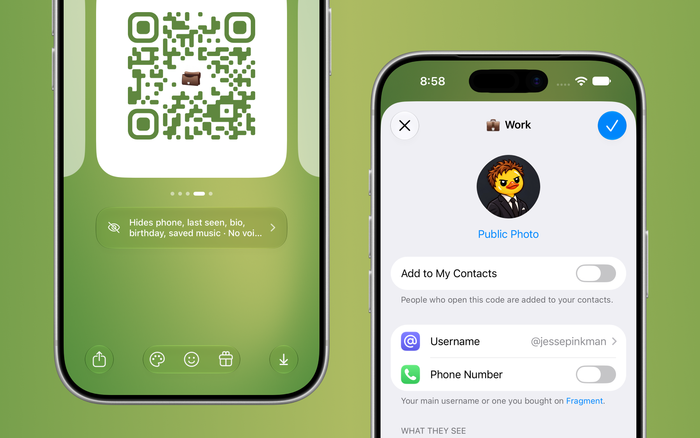

# Profile Links: one account, several QR codes, each with its own privacy

You know the moment: someone attractive asks for your Telegram, and your profile is full of photos and stories with your
wife and son.

Profile Links give one account several QR codes, and each one shows a different you. For every code you decide what the
person who scans it will see: which photo, which username, your phone number, bio, birthday, stories and channel, and
whether they can call you or send you voice messages.



## Why

Today a Telegram profile looks the same to everyone outside your contacts. Privacy settings can hide a phone number or
last seen, but only from everybody at once or from hand-picked people, and you cannot hand-pick someone you have just met.
So you either give a stranger your whole profile, or you do not give them your Telegram at all.

A profile link sets the rules before you meet: one code for work, another for university, another for new acquaintances.
Whoever scans a code sees the profile that code allows.

## What it does

### 1. The carousel

Your own QR code screen becomes a carousel: the **Public** code first, then your codes, then a **New QR Code** card.

- The Public code is the one Telegram has today. It follows your Privacy settings and shows your username under the code.
- Each other code has its own name and icon, shown on the card, and the icon sits in the middle of the code.
- Every code keeps its own look: the Theme, Emoji and Gift tabs change the code you are looking at.
- Under each code, a short line sums up its rules ("Hides phone, last seen, bio · No voice messages"). Tapping it opens
  the rules.
- You can have up to 5 codes, the Public one included. A pill shows how many are used.

### 2. Creating a code

Tapping the New QR Code card opens a small sheet with one field: the code's name, which only you see. While you type, the
icon follows the name: "Work" gets a briefcase, "University" a graduation cap, "Home" a house. The icons are the official
forum topic icons. **Create QR Code** adds the card to the carousel.

A new code starts with what your Privacy settings already show to everybody, and with everything people can do allowed.

### 3. The rules

The rules screen opens from the line under a code:

- **Photo.** One avatar that you swipe, or tap, to turn it over like a coin: your main photo, your public photo, or no
  photo.
- **Add to My Contacts.** People who scan the code are added to your contacts. When it is on, a note field appears in the
  same block; only you see the note.
- **Username.** Your main username, or one you own as a collectible from Fragment. The picker lists them with the date
  each was bought. **Phone Number** shows or hides your number.
- **What they see.** Bio, birthday, stories (all of them, or the ones you pick in the story grid), saved music and your
  personal channel (which one, or none).
- **Privacy.** Last seen and online, forwarded messages, calls, voice messages and group invites. Messages are always
  allowed: that is why you share the code.
- **Add chats to folder.** Chats with people who come through the code go to the folder you pick. The picker shows how
  many chats each folder already holds.
- **Delete Link** removes the code.

**Done** saves the rules. Closing with unsaved changes asks first.

## How it works

- **A client-side design.** No server API exists for this yet, so everything lives on the device. Codes and their rules
  are stored per account in the app's settings. The rules are not applied for the people who scan a code, and scanning
  does not open anything special.
- **The link.** Each code encodes `https://t.me/<username>?=<name>`, with the username the code shares. This format is a
  placeholder for a real per-link token that the server would resolve.
- **What a server would need.** Today's privacy keys can express much of the rules (phone, last seen, bio, birthday,
  calls, voice messages, invites, forwarded messages, gifts). Knowing who scanned which code, a per-link username,
  chosen stories, the personal channel and revoking a code need server support.

## Applying the change

`changes.patch` is the difference from the official Telegram-iOS master at commit `24638bc69b`. From a checkout of that
commit:

```
git apply --check changes.patch
git apply changes.patch
```

Then build as described in the Telegram-iOS README. Everything is in the existing QR code screen,
`submodules/TelegramUI/Components/QrStudioScreen/`. The model and its storage are `Sources/ProfileLinks.swift`, the
carousel is in `Sources/QrStudioScreen.swift` and `Sources/ProfileLinkViews.swift`, the naming sheet is
`Sources/ProfileLinkCreateSheet.swift`, and the rules screen is `Sources/ProfileLinkRulesScreen.swift` with
`Sources/ProfileLinkRulesParts.swift` and `Sources/ProfileLinkPhotoSelector.swift`.
